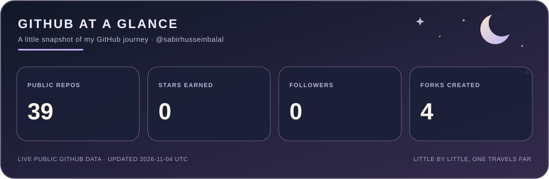

  

  

  

---

## About Me

I'm a curious developer and lifelong learner, building my skills one step at a time. I enjoy solving problems, understanding how things work, and contributing to open-source projects.

## Currently Learning

- Python and problem-solving
- Git and GitHub workflows
- Open-source collaboration
- Writing clear, maintainable code

## Open Source Journey

I’m learning by working on real issues, improving documentation, writing tests, and collaborating with maintainers. Every contribution is another opportunity to become a better developer.

## My Philosophy

> Little by little, one travels far.

I believe consistent learning and meaningful work matter more than chasing numbers.

---

  Thanks for visiting. Feel free to explore my repositories!

